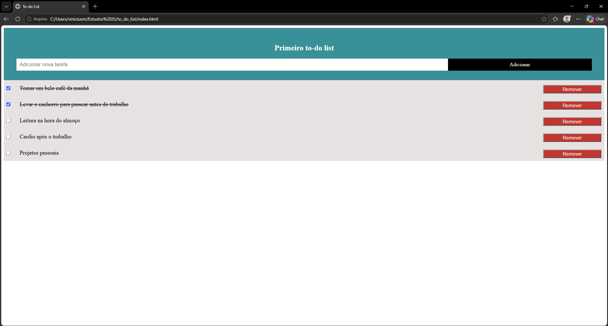

# Primeiro To-do List

Meu primeiro projeto pessoal em JavaScript: uma lista de tarefas simples, feita para praticar e entender cada conceito pesquisando e testando.



## Funcionalidades

- Adicionar tarefas (pelo botão **Adicionar** ou apertando **Enter**)
- Marcar como concluída clicando na tarefa ou no checkbox (os dois ficam sincronizados e o texto é riscado)
- Remover tarefas com o botão **Remover**
- As tarefas ficam salvas no navegador (`localStorage`), então não somem ao recarregar a página

## Tecnologias

- HTML
- CSS (sem frameworks)
- JavaScript puro (sem bibliotecas)

## Como rodar

1. Baixe ou clone este repositório
2. Abra o arquivo `index.html` no navegador

Não precisa instalar nada.

## Estrutura

```
to_do_list/
├── index.html
├── css/
│   └── style.css
└── js/
    └── script.js
```

## O que aprendi

- Selecionar e criar elementos com o DOM (`getElementById`, `createElement`, `appendChild`)
- Reagir a eventos com `addEventListener` (clique e tecla Enter)
- Delegação de eventos: um único "ouvinte" na `ul` cuida dos itens criados depois
- Sincronizar o estado do checkbox com a classe CSS usando `classList.toggle`
- Guardar dados com `localStorage` e converter com `JSON.stringify` / `JSON.parse`
- Como uma regra de CSS global (`input`) pode afetar elementos sem querer, e como corrigir usando um seletor específico (`#meuInput`)
- Usar `position: absolute` para posicionar o checkbox dentro do item

## Ideias para evoluir

- Editar uma tarefa já criada
- Filtros: todas, pendentes e concluídas
- Contador de tarefas pendentes
- Tornar o layout melhor em telas pequenas
